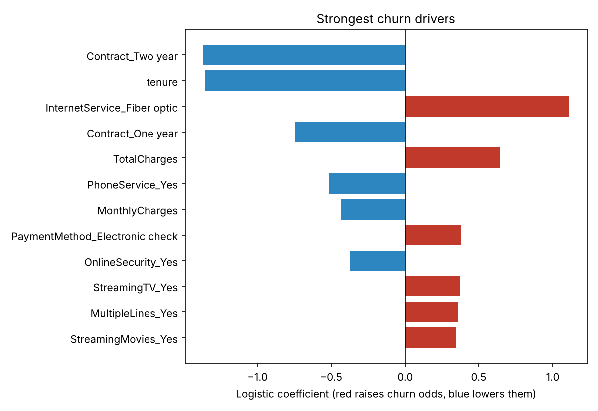

# Telco Customer Churn: Who Leaves, Why, and Who to Call First

**Data.** IBM's Telco Customer Churn sample: 7,043 customers of a fictional telecom provider, created by IBM
for teaching, with demographics, services, contract, billing and whether they left in the last month.
`data/download.sh` fetches it from IBM's GitHub and checks its SHA-256. 11 customers with tenure 0 have no bill
yet and are dropped, leaving 7,032 (26.6% churned).

## Results (`results/metrics.json`)

| Question | Answer |
|---|---|
| Where is churn concentrated? | Month-to-month contracts: **42.7%** vs 11.3% one-year and 2.8% two-year. First year of tenure: 47.7%, falling to 9.5% after four years |
| How well can we rank risk? | Logistic regression, test ROC-AUC **0.836**, PR-AUC 0.623 (5-fold CV 0.847 ± 0.010) |
| Who to call first? | The riskiest 20% of test customers contain **49.7% of all churners** (66.2% of them churn vs 26.6% overall) |
| Operating point | Threshold 0.40, chosen on validation data to keep recall at or above 60%: on test, precision 57.8%, recall 68.5% |
| Strongest drivers | Two-year contract (odds × 0.26), longer tenure (× 0.26 per SD), fiber-optic internet (× 3.0), electronic-check payment (× 1.5) |

Gradient boosting scored 0.840 CV AUC, no better than logistic regression, so the simpler model with readable
drivers was kept. Tenure, monthly charges and total charges are strongly correlated, so their individual
coefficients should not be read in isolation.



## What changed in the October 2026 rebuild

The repo previously held a Colab export that needed a Kaggle key and chose its decision threshold on the test set,
which overstates test performance. The threshold is now picked on a separate validation split, models are compared
by cross-validation, and the test set is scored once.

## Run

```
pip install -r requirements.txt
bash data/download.sh
python src/churn.py
```
